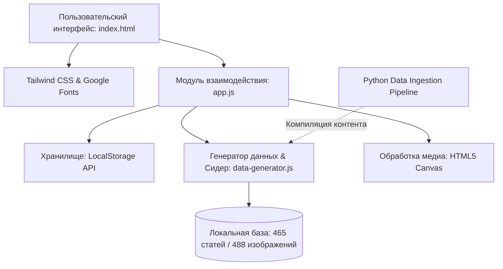

# 🏁 RACE4LIFE. — Motorsport & Simracing Editorial Platform

<p align="center">
  
</p>

<p align="center">
  <strong>Современная цифровая медиа-платформа и автономный журнал об автоспорте, Формуле-1, передовой гоночной инженерии и профессиональном симрейсинге.</strong>
</p>

<p align="center">
  
  
  
  
  
  
</p>

---

## 📖 О проекте

**RACE4LIFE.** — это высокопроизводительное клиентское веб-приложение (Single Page Application) в формате современного диджитал-журнала и медиа-хаба для петролхедов, автоспортивных фанатов и симрейсеров.

Платформа сочетает эстетику премиальных журнальных изданий (журнальная верстка, шрифтовая пара *Plus Jakarta Sans* + *Lora Serif*, палитра глубокого матового карбона с акцентом *Racing Carmine Red*) и развитую функциональность медиа-движка: полноценный CRUD-цикл управления материалами, интерактивный календарный архив публикаций по дням, аналитический дашборд охватов и полнотекстовый поиск.

Приложение поставляется с предзаполненной базой из **465+ уникальных иллюстрированных лонгридов**, распределенных по 4 ключевым направлениям и 31 календарному дню. Архитектура работает полностью автономно в браузере, не требуя серверной базы данных или сборщиков.

---

## ✨ Ключевые возможности

### 📰 1. Журнальный ридер и лента публикаций
* **Иммерсивный режим чтения (Editorial Reader):** модальное окно лонгрида с оптимизированной типографикой (гарнитура Lora, выверенный межстрочный интервал, акцидентные цитаты, поддержка подзаголовков).
* **Порционная подгрузка контента (Pagination / Load More):** рендеринг ленты блоками по 15 материалов для максимального FPS и плавного скролла.
* **Интерактивные реакции:** подсчет просмотров статей при открытии и система отметок «Мне нравится» с мгновенной фиксацией состояния.

### 🛠️ 2. Полноценный CRUD и управление контентом
* **Режим редактора vs Режим читателя:** переключатель в один клик между публичным чистым журнальным видом и панелью автора с инструментами администрирования.
* **Создание и редактирование статей:** модальная форма с валидацией, выбором даты/времени, автогенерацией лида (анонса) из основного текста и быстрой вставкой типографических блоков (`### Подзаголовок`, `> Цитата`).
* **Безопасное удаление:** диалог подтверждения деструктивных действий с превью удаляемого материала.

### 🖼️ 3. Умный медиа-пайплайн и оптимизация изображений
* **Семантический подбор фото (Smart Topic Matcher):** встроенный алгоритм анализирует заголовок и тело статьи по ключевым маркерам (например, *«Direct Drive»*, *«Monza»*, *«Trail Braking»*, *«Telemetry»*, *«Аэродинамика»*) и автоматически подбирает наиболее подходящую фотографию из локальной галереи 480+ снимков.
* **Клиентское сжатие через HTML5 Canvas API:** при загрузке собственного изображения с компьютера файл на лету масштабируется до 1000px и сжимается в JPEG (80% качества), что предотвращает переполнение квоты браузерного `localStorage`.
* **Прямые ссылки и локальные ассеты:** поддержка ввода URL, путей к локальным файлам и Base64.

### 📅 4. Интерактивный календарь-архив
* **Навигация по дням:** двухмесячный календарный виджет (Сентябрь / Октябрь) с отображением дней недели и индикаторов наличия публикаций.
* **Фокусная фильтрация:** мгновенный переход к материалам конкретного гоночного дня одним нажатием с визуальным бейджем и кнопкой быстрого сброса.
* **Контроль покрытия:** счетчик заполненности архивных дат (31 из 31 дня).

### 🔍 5. Поиск, фильтрация и телеметрия
* **Мгновенный живой поиск (Live Search):** фильтрация в реальном времени по заголовкам, анонсам и полному тексту статей.
* **4 тематических направления:**
  * 🏎️ **Формула-1** (`f1-news`) — аналитика Гран-при, регламент 2026, аэродинамика, пит-стратегии и телеметрия.
  * 🔬 **Авто-Научпоп** (`car-science`) — инженерные решения, физика граунд-эффекта, карбон-керамика, термодинамика шин.
  * 🏁 **История треков** (`track-history`) — легендарные автодромы (Спа, Монца, Монако, Сузука, Нюрбургринг, Ле-Ман).
  * 🎮 **Симрейсинг** (`simracing`) — техника пилотажа (trail braking), выбор Direct Drive баз, Load-Cell педалей, настройка FOV.
* **Сортировка по 4 критериям:** «Сначала новые», «Сначала ранние», «По популярности (просмотрам)», «По оценкам (лайкам)».
* **Дашборд аналитики:** подсчет общего охвата (~54 000+ просмотров), читательских реакций (~3 850+ лайков) и процентного соотношения рубрик.

### 💾 6. Портативность данных и автономность
* **Экспорт в JSON:** возможность выгрузить всю актуальную базу публикаций в один клик в структурированный `.json` файл.
* **Восстановление базы (Factory Reset):** сброс к исходному эталонному набору из 465 статей.
* **Zero-Network Ready:** работает без интернета при использовании локальных ассетов, содержит защитные fallback-заглушки (SVG).

---

## 🏗️ Архитектура и стек технологий



| Уровень | Стек / Технология | Описание |
| :--- | :--- | :--- |
| **Core UI** | HTML5, Vanilla JavaScript (ES6+) | Реактивная архитектура без тяжелых фреймворков. Максимальная скорость и чистый DOM-рендеринг |
| **Стилизация** | Tailwind CSS (CDN Edition) | Модульная дизайн-система, кастомная темная палитра `surface-950...600` и гоночный акцент `#C8102E` |
| **Типографика** | Plus Jakarta Sans + Lora Serif | Выверенная связка шрифтов Google Fonts: строгий гротеск для интерфейса и элегантная антиква для статей |
| **Иконки** | Lucide Icons | Легковесные векторные иконки с динамической переинициализацией |
| **Клиентская БД** | Web Storage API (`localStorage`) | Персистентное хранение всех CRUD-операций, состояния лайков, имени автора и выбранного режима |
| **Сжатие медиа** | HTML5 Canvas API | Алгоритм пропорционального масштабирования и сжатия пользовательских картинок на клиенте |
| **Генерация данных** | Python 3.11 Pipeline | Комплекс скриптов для компиляции, нормализации и связки десятков автоспортивных сюжетов |

---

## 📂 Структура проекта

```
RACE4LIFE/
├── index.html                  # Главная страница: журнальная верстка, шапка, 3-колоночный лейаут, модалки
├── app.js                      # Основная клиентская логика: App State, рендеринг, CRUD, поиск, календарь
├── data-generator.js           # Встроенный модуль сидирования базы и семантического сопоставления ассетов
├── articles.js                 # Собранные тексты статей (генерируется tools/build_articles.js из content/*.js)
├── content/                    # Исходники текстов: по 2–3 темы на файл, править здесь
├── tools/build_articles.js     # node tools/build_articles.js — собирает content/*.js в articles.js
├── tools/validate_articles.js  # node tools/validate_articles.js — проверка полноты, длины и дублей
├── tools/legacy/original_data.json # Исходный эталонный массив данных в формате JSON
│
├── images/                     # Локальная библиотека фотографий (480+ снимков)
│   ├── f1_*.jpg                # Фотоматериалы рубрики «Формула-1»
│   ├── sci_*.jpg               # Иллюстрации рубрики «Авто-Научпоп»
│   ├── trk_*.jpg               # Исторические кадры автодромов
│   └── sim_*.jpg               # Симрейсинг-оборудование и кокпиты
│
├── tools/legacy/*.py           # (устарело) старый Python-конвейер коротких заготовок; ниже — его части:
├── build_f1_articles.py        # Python-скрипт сборки расширенных статей
├── generate_*.py               # Модули автоматической генерации и нормализации категорий
├── data_f1.py / data_sci.py    # Пакетные модули контента
├── topics_overview.txt         # Каталог всех 61 тем и их авторских вариаций
└── README.md                   # Документация проекта
```

---

## 🚀 Быстрый старт

Проект не требует компиляции, сборки `npm build` или установки сервера баз данных. Все готово к работе сразу после клонирования.

### Вариант 1. Запуск без установки (Direct Run)
Просто откройте файл `index.html` в любом современном веб-браузере (Chrome, Firefox, Safari, Edge, Opera):
```bash
# Двойной клик по index.html в проводнике
# или через командную строку Windows:
start index.html
```

### Вариант 2. Запуск через локальный веб-сервер

#### С использованием Python:
```bash
# Перейдите в корневую директорию проекта
cd path/to/RACE4LIFE

# Запустите встроенный HTTP-сервер:
python -m http.server 8000
```
После запуска откройте в браузере: `http://localhost:8000`

#### С использованием Node.js (serve / live-server):
```bash
npx serve .
# или
npx live-server
```

---

## 📊 Модель данных статьи (Post Schema)

Каждая публикация платформы нормализована и имеет следующую JSON-структуру:

```json
{
  "id": "post-2026-09-24-1435",
  "title": "Тактическое преимущество поула на Marina Bay: почему чистый воздух здесь ценнее DRS",
  "category": "f1-news",
  "date": "2026-09-24",
  "time": "14:35",
  "timestamp": "2026-09-24T14:35:00.000Z",
  "image": "images/f1_0_0.jpg",
  "excerpt": "На узких улицах Сингапура лидер гонки получает колоссальную фору в виде чистого воздушного потока и оптимальной температуры тормозов.",
  "content": "Развернутый текст лонгрида с подзаголовками, инженерными выкладками и цитатами экспертов...",
  "views": 142,
  "likes": 18,
  "liked": false
}
```

---

## 🎨 Дизайн-система

Интерфейс спроектирован с упором на эстетическое удовольствие от чтения технических материалов:
* **Dark Matte Palette:** фон `surface-950` (`#0E0F12`), карточки `surface-900` (`#141519`), тонкие границы `surface-800` (`#22242B`).
* **Racing Carmine Accent:** фирменный карминно-красный цвет `#C8102E` символизирует динамику и скорость.
* **Микроанимации:** мягкие переходы при наведении, масштабирование обложек `group-hover:scale-105`, адаптивные модальные окна с размытием заднего плана (`backdrop-blur-md`).
* **Адаптивность (Mobile-First):** продуманная сетка от мобильных экранов (компактная панель, выдвижной поиск) до UltraWide-мониторов.

---

## 🛠️ Разработка и генерация контента

Если вы хотите перегенерировать статьи или расширить набор тем, в репозиторий включены Python-инструменты:

```bash
# Просмотр каталога тем и вариаций
cat tools/legacy/topics_overview.txt

# Сборка и валидация модулей
python tools/legacy/build_f1_articles.py
python tools/legacy/inspect_data.py
```

---

## 🤝 Вклад в развитие (Contributing)

Пулл-реквесты приветствуются! Вы можете предложить:
1. Новые темы по автоспорту и симрейсингу.
2. Улучшение алгоритма семантического подбора изображений.
3. Дополнительные опции экспорта (PDF, Markdown).
4. Оптимизацию рендеринга и Accessibility (a11y).

---

## 📄 Лицензия

Проект распространяется под открытой лицензией [MIT](LICENSE). Вы можете свободно использовать, модифицировать и внедрять данный код в собственные проекты.

---

<p align="center">
  Разработано с ❤️ и страстью к автоспорту &bull; <strong>RACE4LIFE.</strong>
</p>
